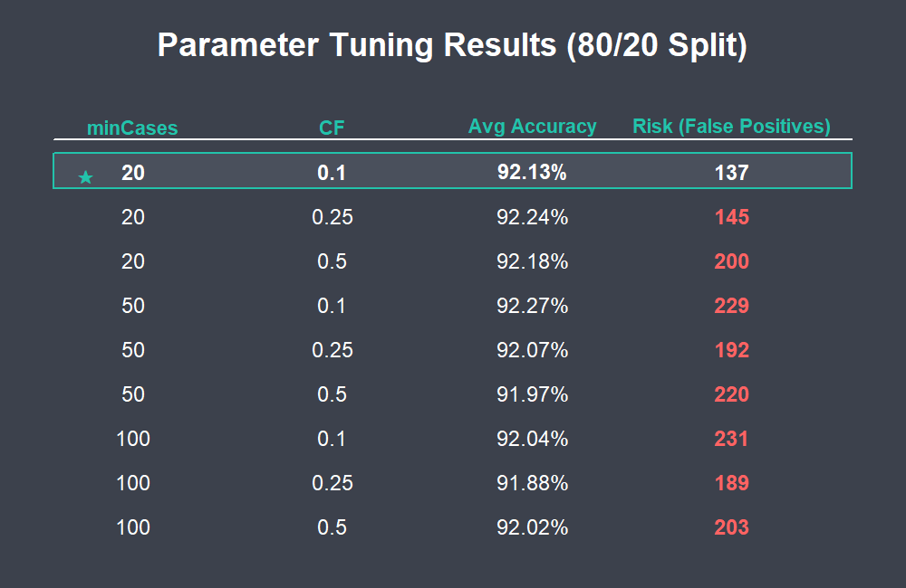
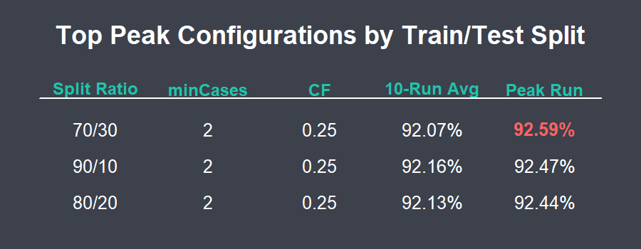
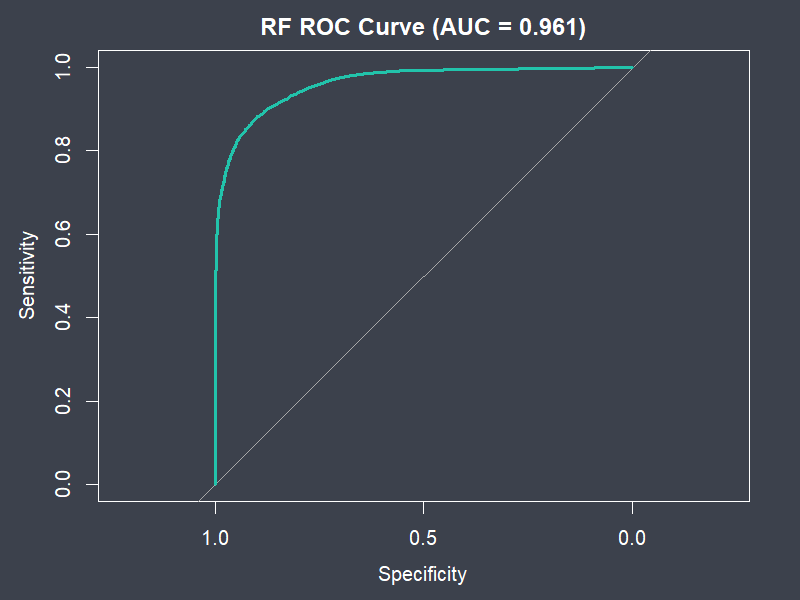
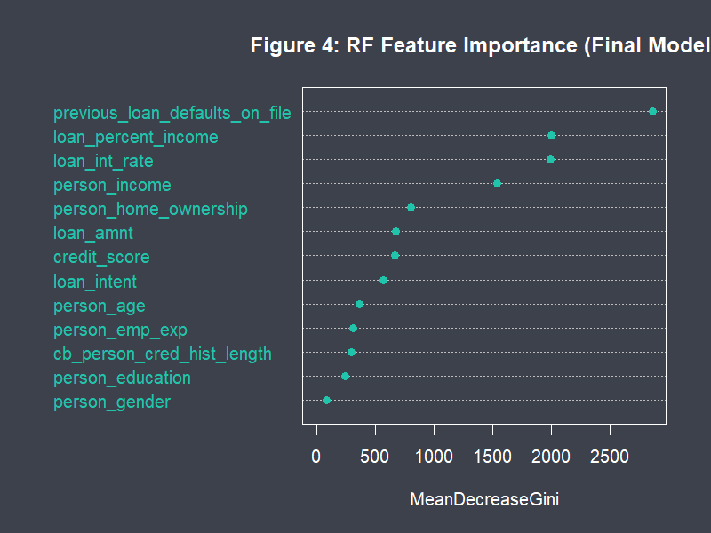

# Business Data Mining in R

Coursework and a two-stage machine learning project from **ISTM 650 Business Data Mining** at Texas A&M University (Spring 2026), all written in R.

The headline piece is a **loan approval classifier**: a C5.0 decision tree (team stage) compared against a random forest (my individual stage), evaluated not just on accuracy but on the financial risk of approving loans that should have been rejected.

---

## Loan Approval Project

**Dataset:** *Synthetic Data for Binary Classification on Loan Approval* (Kaggle): applicant income, credit history, loan amount, interest rate, prior defaults and more, labelled approved or rejected.

### Results at a glance

| | C5.0 Decision Tree | Random Forest |
| :-- | :-: | :-: |
| 10-run average accuracy (80/20 split) | 92.26% | **92.93%** |
| Peak accuracy (80/20 split) | 92.70% | **93.24%** |
| ROC AUC | | **0.976** |
| Interpretability | **High** (traceable rules) | Low (aggregate vote) |
| Regulatory fit (ECOA reason codes) | **Good** | Needs SHAP/LIME |

**Takeaway:** the random forest is slightly more accurate and more stable across splits, but the single C5.0 tree produces explainable decisions, which matters for lending under the Equal Credit Opportunity Act. The right model depends on whether a lender values the last half-point of accuracy or being able to tell an applicant why they were declined.

### Stage 1: C5.0 decision tree (team project, "The 12th MineRs")

[`Project_LoanApproval_ChaseCapron.R`](Project_LoanApproval_ChaseCapron.R)

- Exploratory analysis of loan status, loan amount, credit history length and loan-to-income ratio
- Iterative testing: 10 runs per configuration across 90/10, 80/20 and 70/30 train/test splits
- Grid search over `minCases` and the confidence factor `CF`
- Selected the final model by **lowest false positives first** (approving a loan that should be rejected is the costly error), then accuracy: `minCases = 20, CF = 0.1` cut false positives to 137 versus up to 231 for other settings, at 92.13% accuracy

  
  

### Stage 2: Random forest (individual)

[`Project_LoanApproval_Part2_ChaseCapron.R`](Project_LoanApproval_Part2_ChaseCapron.R)

- **Data quality:** descriptive statistics before and after cleaning, missing-data pattern analysis (`mice`, `VIM`), and outlier treatment with winsorization (capping values beyond 1.5 × IQR at the 5th/95th percentiles)
- **Stratified sampling** with `caret` so approval rates match across train and test sets
- **10-run intensive testing** per configuration with different seeds, reporting average and peak accuracy plus the best run's confusion matrix
- **Tuning:** train/test ratio, `nodesize` sweep and `ntree`; the default forest (`nodesize = 1, ntree = 100`) beat the tuned variants
- **Evaluation:** ROC curve and AUC, feature importance, partial dependence, and a false-positive cost estimate at 50% loss given default

  
  

**Strongest predictors:** a previous loan default on file, loan amount as a share of income, interest rate, and applicant income.

---

## Coursework

| File | Topic | Methods / packages |
| :-- | :-- | :-- |
| `Lab_1`, `Assignment_1` | R fundamentals | vectors, data frames, basic statistics |
| `Lab_2`, `Assignment_2` | Data quality and exploration | `mice`, `VIM`, histograms, boxplots, correlation |
| `Lab_3`, `Assignment_3` | Decision trees | `C50` |
| `Lab_4` | Neural networks | `neuralnet` |
| `Lab_5`, `Assignment_4` | Naive Bayes classification | `e1071` |
| `Lab_6` | Support vector machines | `e1071` |
| `Lab_7`, `Assignment_5` | Clustering | `kmeans`, `ggplot2` |
| `Lab_8`, `Assignment_6` | Association rule mining | `arules`, `arulesViz`, `igraph` |
| `Lab_9`, `Assignment_7` | Model comparison: logistic regression vs. decision tree | `glm`, `C50`, `pROC` |

Datasets used across the labs (Titanic, Iris, Mushroom, Adult, Abalone, Groceries and others) are included as CSV files.

---

**Tools:** R · C50 · randomForest · caret · e1071 · arules · pROC · ggplot2 · mice · VIM
